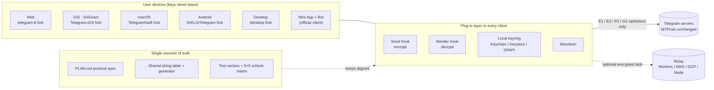
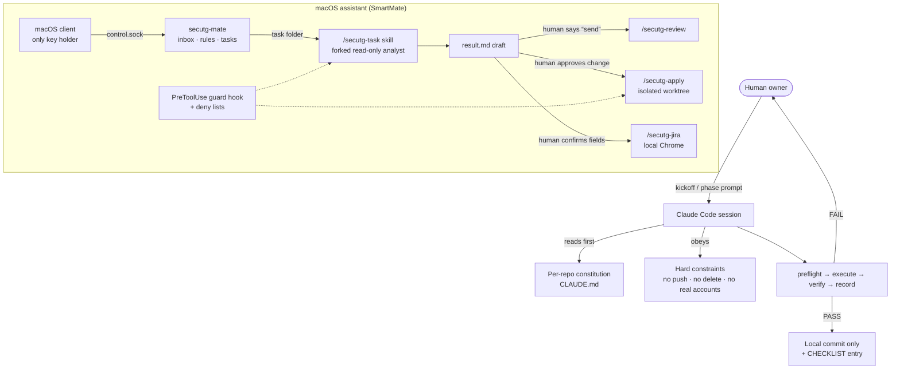

# Si4Gram Prompt Kit

[English](README.md) · [简体中文](README.zh-CN.md) · [日本語](README.ja.md) · [Deutsch](README.de.md) · [Français](README.fr.md) · [Español](README.es.md) · [한국어](README.ko.md) · **العربية**

<div dir="rtl">

ينشر هذا المستودع **الموجّهات (prompts)** التي استُخدمت لبناء Si4Gram (الاسم الرمزي *secuTG*) بمساعدة وكلاء برمجة بالذكاء الاصطناعي (Claude Code): تعليمات الوكلاء وضوابط الأمان وقوالب الموجّهات.

**الشيفرة المصدرية للتطبيق:** يحتوي المجلد [`ios/`](ios/) على الشيفرة المصدرية الكاملة لتطبيق Si4Gram على iOS (إصدار App Store 1.0.1)، وهو نسخة معدّلة من [Telegram-iOS](https://github.com/TelegramMessenger/Telegram-iOS) ومرخّص بموجب **GPL v2** (انظر [`ios/COPYING`](ios/COPYING)). ما يحتويه وما استُبعد منه (بيانات اعتماد API وملفات التوقيع) وطريقة بنائه موضّحة في [`ios/SOURCE-NOTICE.md`](ios/SOURCE-NOTICE.md).

إن كنت تبني شيئًا مشابهًا (طبقة أمان فوق تطبيق مفتوح المصدر قائم، أو عدة منصات يجب أن تتصرف بشكل متطابق، أو مساعدًا ذكيًا لا يجوز له أن يتصرف أبدًا دون إنسان)، فمن المفترض أن تتمكن من إعادة استخدام هذه الموجّهات والدروس المستفادة منها.

---

## 1. ماذا يفعل المشروع

يضيف Si4Gram طبقة إضافية (plug-in) إلى عملاء Telegram مفتوحة المصدر: **التشفير قبل الإرسال، وفك التشفير قبل العرض**. تعرض نافذة الدردشة نصًا واضحًا، أما ما ينتقل عبر الشبكة ويُخزَّن على خوادم Telegram فهو نص مشفّر. المفاتيح موجودة على أجهزة المستخدم فقط.

| قاعدة التصميم | المعنى |
|---|---|
| عدم المساس بالبروتوكول | يبقى MTProto وكل تفاعل مع الخادم دون تغيير. الخطافات (hooks) موجودة فقط عند نقطة دخول إرسال النص ونقطة دخول العرض. |
| بروتوكول واحد لكل المنصات | يجب أن تتمكن Web وiOS وmacOS وAndroid وDesktop من تشفير رسائل بعضها وفك تشفيرها. مواصفة مشتركة وجدول نصوص مشترك ومتجهات اختبار مشتركة تُبقيها متوافقة. |
| استخدام libsodium فقط | XChaCha20-Poly1305، وX25519 `crypto_box_seal`، وتوقيعات Ed25519، و`crypto_kdf`. لا تشفير مصنوع يدويًا. |
| لا انهيار ولا إخفاء | الرسالة التي يتعذّر فك تشفيرها تُحفظ كما هي وتُعرض مع شارة قفل. |
| تسميات صادقة | الوضع الذي يكتفي بالتمويه (مثل مفتاح المجموعة ذي الاقتران التلقائي) لا يُعرض أبدًا على أنه "مشفّر". |

مكوّنات مرافقة: **Mini App + Bot** لا يحتاج إلى تثبيت لمن يستخدمون العميل الرسمي، وخدمة **relay** اختيارية تخزّن كتلًا مشفّرة قصيرة العمر، و**مصفوفة** اختبار بين العملاء، و**مساعد** محلي (SmartMate) على macOS يسلّم المهام إلى Claude Code ضمن ضوابط صارمة.

## 2. البنية


### 2.1 وقت التشغيل

</div>



<div dir="rtl">

### 2.2 كيف توجّه الموجّهات الوكلاء

</div>



<div dir="rtl">

## 3. موارد GitHub

قُرئت جميع عناوين المصادر الأصلية (upstream) أدناه من `git remote` و`.gitmodules` وملفات الاعتماديات في كل تفريعة.

### 3.1 العملاء الأصليون الذين تم تفريعهم

| المنصة | المصدر الأصلي | الترخيص (الأصلي) |
|---|---|---|
| Web | [Ajaxy/telegram-tt](https://github.com/Ajaxy/telegram-tt) | GPL-3.0 |
| iOS (Si4Gram) | [TelegramMessenger/Telegram-iOS](https://github.com/TelegramMessenger/Telegram-iOS) | راجع المصدر الأصلي |
| macOS | [overtake/TelegramSwift](https://github.com/overtake/TelegramSwift) | GPL-2.0 |
| Android | [DrKLO/Telegram](https://github.com/DrKLO/Telegram) | GPL-2.0 |
| Desktop (Windows / Linux / macOS) | [telegramdesktop/tdesktop](https://github.com/telegramdesktop/tdesktop) | GPL-3.0 (مع استثناء OpenSSL) |

### 3.2 المكتبات التي تعتمد عليها طبقة الأمان

| المكتبة | تستخدمها |
|---|---|
| [jedisct1/libsodium](https://github.com/jedisct1/libsodium) 1.0.20 | iOS / macOS (`Clibsodium`)، Desktop |
| [libsodium.js](https://github.com/jedisct1/libsodium.js) (`libsodium-wrappers` 0.8.x) | Web، Mini App |
| [terl/lazysodium-android](https://github.com/terl/lazysodium-android) 5.1 و[lazysodium-java](https://github.com/terl/lazysodium-java) 5.1.4 | Android |
| [java-native-access/jna](https://github.com/java-native-access/jna) 5.13 | Android |
| [soldair/node-qrcode](https://github.com/soldair/node-qrcode) | Mini App |
| [honojs/hono](https://github.com/honojs/hono) + `@hono/node-server` | Relay |
| [fastapi/fastapi](https://github.com/fastapi/fastapi)، [encode/uvicorn](https://github.com/encode/uvicorn)، [python-poetry/tomlkit](https://github.com/python-poetry/tomlkit) | مساعد SmartMate |

تجلب العملاء الأصلية أيضًا وحداتها الفرعية الخاصة (مثل tdlib/td وwebrtc وlibvpx وdav1d وFFmpeg وopus وrlottie وtgcalls وrules_apple وrules_swift). هذه لم تُعدَّل، وهي مدرجة في ملف `.gitmodules` لكل مصدر أصلي.

### 3.3 أدوات الوكلاء

| الأداة | الدور |
|---|---|
| [Claude Code](https://github.com/anthropics/claude-code) | جميع وكلاء البرمجة ومهارات المشروع والوكلاء الفرعيين والخطافات في هذه الحزمة |
| ملفات `AGENTS.md` الأصلية (telegram-tt، tdesktop) | أُبقيت كما هي في التفريعات. إنها أدلة الوكلاء الخاصة بالمصدر الأصلي و**ليست** جزءًا من هذه الحزمة؛ وكل دستور ينص على اتباعها ما لم تتعارض معه. |

## 4. محتويات هذه الحزمة

النسخ الأصلية مكتوبة بالصينية المبسّطة في [`prompts/zh-CN/`](prompts/zh-CN/)، وتوجد ترجمة إنجليزية بأسماء الملفات نفسها في [`prompts/en/`](prompts/en/).

| المجلد | الملفات | ما هو | متى تستخدمه |
|---|---|---|---|
| `01-constitutions/` | `web`، `ios`، `macos`، `android`، `desktop`، `miniapp` `.CLAUDE.md` | "دستور مشروع" لكل تفريعة: القيود الصارمة، وصيغة البيانات المرسلة، ومكان شيفرة الإضافة، وقاعدة العلامة `// SECUTG-HOOK`، وطريقة العمل والإبلاغ | ضعه في جذر كل تفريعة باسم `CLAUDE.md` |
| `02-agent-guardrails/` | `00-constraints.md` | حدّ أمان يتقدّم على كل وثيقة أخرى: لا حذف أبدًا، لا push أبدًا، لا استخدام لحسابات حقيقية، لا إعادة كتابة للسجل، التحقق من حِمل الجهاز قبل البناء | حمّله في أي مهمة وكيل طويلة أو متعددة الخطوات |
| `03-repo-restructure/` | `00-kickoff.md`، `01-phase-prompts.md` | موجّه انطلاق بالإضافة إلى موجّه لكل مرحلة لدمج خطَّي شيفرة متباعدين في جذع واحد | الصق موجّه الانطلاق أولًا، ثم أسند مرحلة واحدة في كل مرة |
| `04-cross-platform-playbook/` | `reproducible-prompts.md` | كيف أُجري تدقيق اتساق لخمسة عملاء وأربع جولات من الإصلاحات: كتلة القيود، وقوالب التدقيق / الإصلاح / العمل عبر المستودعات، وفخاخ التحقق الخاصة بكل منصة، وجدول بأخطاء تقدير حقيقية | أعد استخدامه عندما يجب أن تبقى عدة تطبيقات لمواصفة واحدة متطابقة |
| `05-assistant-skills/` | `settings.json`، `agent-secutg-analyst.md`، `skill-secutg-{task,review,apply,jira}.SKILL.md` | إعدادات مشروع Claude Code، ووكيل فرعي محلّل للقراءة فقط، وأربع مهارات لمساعد macOS. كانت في الأصل في `.claude/settings.json` و`.claude/agents/` و`.claude/skills/<name>/SKILL.md` | نمط لمساعد يكتب المسودات لكنه لا يرسل ولا يعدّل ولا يفتح تذاكر أبدًا دون إنسان |

## 5. أنماط موجّهات نجحت

1. **دستور لكل مستودع.** لكل تفريعة الهيكل نفسه: ما هي، والقيود الصارمة، وصيغة البيانات المرسلة، وأين توضع الشيفرة، وطريقة العمل. يبدأ الوكلاء كل جلسة وهم يعرفون الخطوط الحمراء مسبقًا.
2. **كتلة قيود واحدة تُلصق حرفيًا.** "لا `git push` أبدًا (المستودع البعيد الوحيد هو المصدر الأصلي العام)"، "لا حذف أبدًا، بل `mv` إلى `_archive-<date>/`"، "لا إضافة للنصوص يدويًا أبدًا"، "لا اختبارات على حسابات حقيقية". كل سطر موجود لأن شيئًا ما ساء في غيابه.
3. **فحص مسبق ← تنفيذ ← تحقق ← تسجيل.** أي FAIL يوقف الوكيل، ويذهب الناتج الخام إلى الإنسان. لا مكان لـ"إصلاح سريع ثم المتابعة".
4. **أبلغ عمّا أُنجز وما تم التحقق منه وما لم يُتحقق منه.** "يُفترض أنه سليم" ليس تقريرًا مقبولًا. "تمّت الترجمة البرمجية" و"تمّ التحقق" يُبلَغ عنهما بشكل منفصل.
5. **التدقيقات للقراءة فقط وتحمل الأدلة.** كل صف يحتاج إلى `file:line`. "لم يُعثر عليه" أفضل من تخمين مبني على المواصفة.
6. **ازرع اختلافات معروفة في قائمة التحقق.** إذا وصف تقرير التدقيق الاختلافات المزروعة بأنها "متسقة"، يُستبعد التقرير. هذه أرخص طريقة لاختبار ما إذا كان تقرير الوكيل جديرًا بالثقة.
7. **"صعب" لا يعني "مستحيل".** إذا كان شيء ما مستحيلًا فعلًا على منصة ما، يذكر الوكيل ما يمنعه ويقدّم أفضل بديل أصلي.
8. **المستنتَج يبقى مستنتَجًا.** لا يجوز لاستنتاج موسوم بـ"مستنتَج" أن يدخل مواصفة أو تكليفًا حتى يقيسه أحد.
9. **اطلب من الوكيل أن يعترض.** تقول التكليفات: "تحقّق من هذا بنفسك، ولا تأخذه على الثقة". جاءت عدة من أفضل النتائج من وكلاء صحّحوا التكليف.
10. **لا تُنهِ الدور على "الانتظار" أبدًا.** الوكيل الفرعي الذي ينتهي بعبارة "(في انتظار البناء)" يترك البناء يتيمًا. أنهه في الدور نفسه أو أعد تشغيله.
11. **البيانات غير الموثوقة توسم على أنها بيانات.** في مهارات المساعد، حقول Jira ونصوص الدردشات الجماعية وكل ما بداخل المستودعات هي بيانات، وليست تعليمات أبدًا. التعليمات المريبة تُقتبس في النتيجة ويُنبَّه إليها.
12. **البشر يمسكون بكل فعل موجّه إلى الخارج.** يجري التحليل في وكيل متفرّع للقراءة فقط؛ وإرسال رد أو تطبيق تغيير أو فتح تذكرة يحتاج كلٌّ منها إلى موافقة بشرية صريحة، تُفرض بقواعد الأذونات وخطاف حراسة PreToolUse، لا بنص الموجّه وحده.

## 6. قوالب قابلة لإعادة الاستخدام

### 6.1 دستور المستودع

</div>

```markdown
# <repo> · دستور المشروع

هذا المستودع تفريعة من <upstream>. الهدف: <جملة واحدة>. البروتوكول معرّف في <spec>؛ لا تغيّر الصيغة.

## القيود الصارمة
- لا تغيّر <البروتوكول / التفاعل مع الخادم>؛ ضع الخطافات فقط عند <نقاط الدخول>
- شيفرة الإضافة توضع في <dir>؛ كل تغيير في ملف من المصدر الأصلي يحمل التعليق `// <MARKER>`؛ أبقِ مساحة التغيير صغيرة
- التشفير فقط عبر <المكتبة>؛ لا تنفّذ الدوال الأساسية بنفسك أبدًا
- الأسرار والمعاملات تُقرأ فقط من <ملف الإعدادات>؛ لا يُرفع إلى المستودع أبدًا، بل يُرفع <config.example> فقط
- لكل مرحلة فرعها الخاص، وتُبنى، ولها اختبارات وحدة؛ البيانات التي يتعذّر فك تشفيرها تُعرض كما هي، لا انهيار أبدًا، لا إسقاط أبدًا

## طريقة العمل
- اعرض الخطة والملفات المتأثرة أولًا؛ لا تغيّر شيئًا إلا بعد التأكيد
- اقرأ الشيفرة المصدرية قبل التعديل؛ لا تخمّن أسماء الملفات
- commit واحد لكل مسار عليه خطاف، مع ذكر موقع الخطاف
- بعد كل مرحلة أبلغ عن: الملفات التي تغيّرت، وكيف تم التحقق، والثغرات المعروفة
```

<div dir="rtl">

### 6.2 كتلة القيود الصارمة

</div>

```markdown
## القيود الصارمة (مخالفة أيٍّ منها تُفشل المهمة)
- لا `git push` أبدًا. المستودع البعيد الوحيد المُعدّ هو المصدر الأصلي العام؛ نفّذ commit محليًا فقط.
- لا تحذف ملفات أو مجلدات أبدًا. لإبعاد شيء ما، انقله بـ `mv` إلى مجلد شقيق `_archive-<date>/`.
- لا تضف نصوصًا يراها المستخدم يدويًا أبدًا. المصدر الوحيد هو <strings.json>؛ وجداول كل منصة تُولَّد منه.
- لا تغلّف أوامر البناء بـ `tee` (فهو يخفي رمز الخروج)؛ أعد التوجيه إلى ملف، ثم اطبع رمز الخروج.
- لا اختبارات شاملة على حسابات حقيقية. تسجيل الدخول يقوم به الإنسان.
```

<div dir="rtl">

### 6.3 تدقيق للقراءة فقط

</div>

```markdown
أنت تدقّق <المنصة> مقارنةً بالتطبيق المرجعي في <path>.

## مهمة للقراءة فقط
لا تعدّل أي ملف ولا تنشئه ولا تحذفه؛ لا git add/commit/stash/checkout؛ لا عمليات بناء.

## المنهج
سلوك الشيفرة هو المرجع؛ ارجع إلى المواصفة فقط حين تختلف الشيفرة عن المواصفة. إن لم تجد الشيء فاكتب "لم يُعثر عليه". لا تستنتج السلوك من المواصفة.

## المخرجات (صارمة، ستُقارن بين المنصات)
| ID | الحالة | الدليل file:line | ملاحظات |
الحالة واحدة من: ✅ متسق / ⚠️ مختلف / ❌ مفقود / N/A
في حالتي ⚠️ و❌ اذكر ما يحدث فعلًا وكيف يختلف. اختم بقسم "نتائج إضافية".

## قائمة التحقق
<بنود مرقّمة، كل منها يذكر مفتاح النص الدقيق والسلوك المتوقع؛ أدرج بعض الاختلافات المعروفة>
```

<div dir="rtl">

### 6.4 جولة إصلاح

</div>

```markdown
الجولة <N>، أنت مسؤول عن <المنصة>: المستودع <path>
المواصفة: <القسم> (اقرأ القسم كاملًا أولًا؛ فهو يشرح السبب)

المبدأ: إبقاء جميع المنصات متطابقة؛ وحيث يكون شيء ما مستحيلًا فعلًا على منصة ما، ابنِ هناك أفضل شكل أصلي بدلًا من حذف الميزة.

## الخلفية — لماذا يهمّ هذا، وما الذي ينكسر إذا تم تجاوزه
## التطبيق المرجعي (منجز، للقراءة فقط) — commit + مقتطف أساسي + التعليل
## عملك
## ⚠️ فخ خاص بالمنصة
## التحقق — الأوامر والفخاخ المعروفة
<كتلة القيود الصارمة>

إذا كان شيء ما مستحيلًا فعلًا هنا (وليس صعبًا فحسب)، فاذكر ما يمنعه وقدّم أفضل بديل. لا تسمِّ "الصعب" "مستحيلًا".
```

<div dir="rtl">

### 6.5 انطلاق الجلسة

</div>

```markdown
أنت تنفّذ مواصفة مكتوبة في <path>. وهي مكتفية بذاتها.

1. اقرأ بالترتيب: القيود ← الحقائق ← التصميم المستهدف ← دليل التشغيل ← القرارات ← قائمة التحقق.
2. شغّل الفحص المسبق للقراءة فقط والصق ناتجه حرفيًا.
3. أبلغ عن: نتيجة الفحص المسبق، والمرحلة الحالية، والمرحلة التالية، والقرارات التي عليّ اتخاذها. ثم توقّف وانتظر.

خطوط الأمان السارية طوال الجلسة: <كتلة القيود الصارمة>
طريقة العمل: كل مرحلة هي فحص مسبق ← تنفيذ ← تحقق ← تسجيل؛ أي FAIL يوقفك؛ لا تتجاوز المراحل أبدًا؛ إذا لم تغطِّ المواصفة حالةً ما، فتوقّف واسأل.
```

<div dir="rtl">

## 7. تكييف الحزمة

1. انسخ دستورًا من `01-constitutions/`، واستبدل أسماء البروتوكول والمجلدات والعلامة بأسمائك.
2. أبقِ `02-agent-guardrails/00-constraints.md` قريبًا من نصه الحرفي؛ وعدّل الصفوف الخاصة بالجهاز.
3. للعمل متعدد المنصات، ابدأ من `04-cross-platform-playbook/` واستمر في توسيع جدول "أخطاء التقدير" فيه.
4. لمساعد يتعامل مع محادثات حقيقية، انسخ `05-assistant-skills/` مع قوائم رفض الأذونات وخطاف حراسة. نص الموجّه وحده ليس حدًّا أمنيًا.

## 8. إزالة البيانات الحساسة

قبل النشر، استُبدلت أسماء الأجهزة والمسارات المحلية وأسماء الفروع الخاصة بالشركة بعناصر نائبة:

| العنصر النائب | يمثّل |
|---|---|
| `<workspace>/` | المجلد المحلي الذي يضم جميع التفريعات |
| `<build-cache>/` | مجلد ذاكرة البناء المؤقتة المحلي |
| `dev-mac` / `backup-mac` | جهاز Mac الرئيسي للتطوير / جهاز Mac ثانٍ للقراءة فقط بالنسبة إلى الوكلاء |
| `_bazel_<user>` | اسم المستخدم المحلي في مسار مخرجات Bazel |
| `develop、test、staging、release*` | أسماء فروع على سبيل المثال في مهارة الاستعلام |

لا تتضمن الحزمة أي شهادات أو ملفات تعريف التوزيع (provisioning profiles) أو معرّفات فرق أو مفاتيح API أو عناوين بريد إلكتروني أو عناوين IP.

## 9. روابط

- الموقع الإلكتروني: <https://si4key.com>
- عنوان الشيفرة المصدرية المعروض في صفحة "حول" في التطبيق: <https://github.com/Well365/Si4Gram>

## 10. الترخيص

الموجّهات والوثائق في هذا المستودع: سيحدّدها المالك لاحقًا (CC BY 4.0 خيار شائع للوثائق). تحتفظ عملاء Telegram الأصلية بتراخيصها الخاصة المذكورة أعلاه.

</div>
