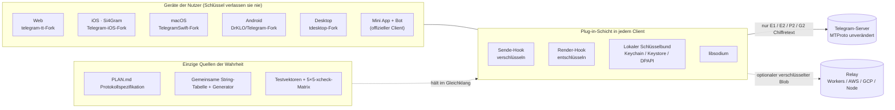
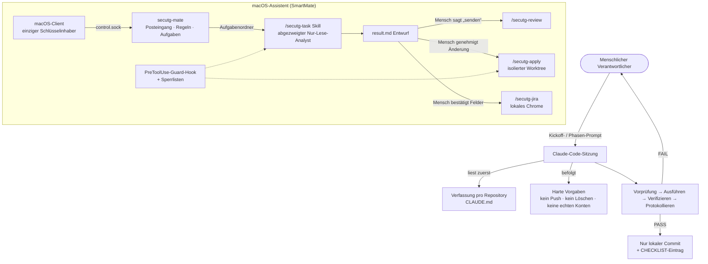

# Si4Gram Prompt Kit

[English](README.md) · [简体中文](README.zh-CN.md) · [日本語](README.ja.md) · **Deutsch** · [Français](README.fr.md) · [Español](README.es.md) · [한국어](README.ko.md) · [العربية](README.ar.md)

Dieses Repository veröffentlicht die **Prompts**, mit denen Si4Gram (Codename *secuTG*) mithilfe von KI-Coding-Agenten (Claude Code) entwickelt wurde: Agenten-Anweisungen, Leitplanken und Prompt-Vorlagen.

**Quellcode der App:** Der Ordner [`ios/`](ios/) enthält den vollständigen Quellcode der Si4Gram-iOS-App (App Store 1.0.1). Er ist eine veränderte Fassung von [Telegram-iOS](https://github.com/TelegramMessenger/Telegram-iOS) und steht unter der **GPL v2** (siehe [`ios/COPYING`](ios/COPYING)). Was enthalten ist, was weggelassen wurde (API-Zugangsdaten, Signierdateien) und wie man baut, steht in [`ios/SOURCE-NOTICE.md`](ios/SOURCE-NOTICE.md).

Wenn du etwas Ähnliches baust (eine Sicherheitsschicht auf einer bestehenden Open-Source-App, mehrere Plattformen, die sich exakt gleich verhalten müssen, oder einen KI-Assistenten, der nie ohne einen Menschen handeln darf), sollten die Prompts und die Lehren dahinter wiederverwendbar sein.

---

## 1. Was das Projekt macht

Si4Gram ergänzt die Open-Source-Clients von Telegram um eine Plug-in-Schicht: **vor dem Senden verschlüsseln, vor dem Anzeigen entschlüsseln**. Das Chatfenster zeigt Klartext; was über das Netz geht und auf den Telegram-Servern liegt, ist Chiffretext. Die Schlüssel liegen nur auf den Geräten der Nutzer.

| Designregel | Bedeutung |
|---|---|
| Das Protokoll nicht anfassen | MTProto und jede Server-Interaktion bleiben unverändert. Hooks sitzen nur am Einstiegspunkt für das Senden von Text und am Einstiegspunkt für das Rendern. |
| Ein Protokoll, alle Plattformen | Web, iOS, macOS, Android und Desktop müssen die Nachrichten der jeweils anderen ver- und entschlüsseln können. Eine gemeinsame Spezifikation, eine gemeinsame String-Tabelle und gemeinsame Testvektoren halten sie im Gleichklang. |
| Nur libsodium verwenden | XChaCha20-Poly1305, X25519 `crypto_box_seal`, Ed25519-Signaturen, `crypto_kdf`. Keine selbstgebaute Kryptografie. |
| Nie abstürzen, nie verschlucken | Eine Nachricht, die sich nicht entschlüsseln lässt, bleibt unverändert und wird mit einem Schloss-Symbol angezeigt. |
| Ehrliche Bezeichnungen | Ein Modus, der nur verschleiert (zum Beispiel der Gruppenschlüssel aus der automatischen Kopplung), wird nie als „verschlüsselt“ angezeigt. |

Begleitende Bausteine: eine **Mini App + Bot** ohne Installation für Nutzer des offiziellen Clients, ein optionaler **Relay**-Dienst, der kurzlebige verschlüsselte Blobs speichert, eine clientübergreifende Test-**Matrix** und ein lokaler **Assistent** (SmartMate) unter macOS, der Aufgaben unter strengen Leitplanken an Claude Code übergibt.

## 2. Architektur


### 2.1 Laufzeit



### 2.2 Wie die Prompts die Agenten steuern



## 3. GitHub-Ressourcen

Alle folgenden Upstream-Adressen wurden aus `git remote`, `.gitmodules` und den Abhängigkeitsdateien des jeweiligen Forks ausgelesen.

### 3.1 Geforkte Upstream-Clients

| Plattform | Upstream | Lizenz (Upstream) |
|---|---|---|
| Web | [Ajaxy/telegram-tt](https://github.com/Ajaxy/telegram-tt) | GPL-3.0 |
| iOS (Si4Gram) | [TelegramMessenger/Telegram-iOS](https://github.com/TelegramMessenger/Telegram-iOS) | siehe Upstream |
| macOS | [overtake/TelegramSwift](https://github.com/overtake/TelegramSwift) | GPL-2.0 |
| Android | [DrKLO/Telegram](https://github.com/DrKLO/Telegram) | GPL-2.0 |
| Desktop (Windows / Linux / macOS) | [telegramdesktop/tdesktop](https://github.com/telegramdesktop/tdesktop) | GPL-3.0 (mit OpenSSL-Ausnahme) |

### 3.2 Bibliotheken, auf die sich die Sicherheitsschicht stützt

| Bibliothek | Verwendet von |
|---|---|
| [jedisct1/libsodium](https://github.com/jedisct1/libsodium) 1.0.20 | iOS / macOS (`Clibsodium`), Desktop |
| [libsodium.js](https://github.com/jedisct1/libsodium.js) (`libsodium-wrappers` 0.8.x) | Web, Mini App |
| [terl/lazysodium-android](https://github.com/terl/lazysodium-android) 5.1 und [lazysodium-java](https://github.com/terl/lazysodium-java) 5.1.4 | Android |
| [java-native-access/jna](https://github.com/java-native-access/jna) 5.13 | Android |
| [soldair/node-qrcode](https://github.com/soldair/node-qrcode) | Mini App |
| [honojs/hono](https://github.com/honojs/hono) + `@hono/node-server` | Relay |
| [fastapi/fastapi](https://github.com/fastapi/fastapi), [encode/uvicorn](https://github.com/encode/uvicorn), [python-poetry/tomlkit](https://github.com/python-poetry/tomlkit) | SmartMate-Assistent |

Die Upstream-Clients binden außerdem eigene Submodule ein (zum Beispiel tdlib/td, webrtc, libvpx, dav1d, FFmpeg, opus, rlottie, tgcalls, rules_apple, rules_swift). Diese sind unverändert und in der `.gitmodules` des jeweiligen Upstreams aufgeführt.

### 3.3 Agenten-Werkzeuge

| Werkzeug | Rolle |
|---|---|
| [Claude Code](https://github.com/anthropics/claude-code) | Alle Coding-Agenten, Projekt-Skills, Sub-Agenten und Hooks in diesem Kit |
| Upstream-Dateien `AGENTS.md` (telegram-tt, tdesktop) | Unverändert in den Forks belassen. Es sind die eigenen Agenten-Leitfäden des Upstreams und **nicht** Teil dieses Kits; jede Verfassung schreibt vor, ihnen zu folgen, soweit sie nicht im Widerspruch stehen. |

## 4. Was in diesem Kit steckt

Die Originale sind in vereinfachtem Chinesisch unter [`prompts/zh-CN/`](prompts/zh-CN/); eine englische Übersetzung mit denselben Dateinamen liegt unter [`prompts/en/`](prompts/en/).

| Ordner | Dateien | Was es ist | Wann man es nutzt |
|---|---|---|---|
| `01-constitutions/` | `web`, `ios`, `macos`, `android`, `desktop`, `miniapp` `.CLAUDE.md` | Eine „Projektverfassung“ pro Fork: harte Vorgaben, Wire-Format, wo der Plug-in-Code liegt, die Regel zum Marker `// SECUTG-HOOK`, wie gearbeitet und berichtet wird | Im Wurzelverzeichnis jedes Forks als `CLAUDE.md` ablegen |
| `02-agent-guardrails/` | `00-constraints.md` | Sicherheitsgrenze, die jedes andere Dokument übersteuert: nie löschen, nie pushen, nie echte Konten verwenden, keine Umschreibung der Historie, vor dem Build die Maschinenlast prüfen | In jede lang laufende oder mehrstufige Agentenaufgabe laden |
| `03-repo-restructure/` | `00-kickoff.md`, `01-phase-prompts.md` | Kickoff-Prompt plus ein Prompt pro Phase, um zwei auseinandergelaufene Codelinien zu einem Trunk zusammenzuführen | Zuerst den Kickoff einfügen, dann jeweils eine Phase zuweisen |
| `04-cross-platform-playbook/` | `reproducible-prompts.md` | Wie ein Konsistenz-Audit über fünf Clients und vier Korrekturrunden abliefen: der Vorgabenblock, Vorlagen für Audit / Korrektur / repositoryübergreifende Arbeit, plattformspezifische Fallen bei der Verifikation und eine Tabelle echter Fehleinschätzungen | Wiederverwenden, wenn mehrere Implementierungen einer Spezifikation identisch bleiben müssen |
| `05-assistant-skills/` | `settings.json`, `agent-secutg-analyst.md`, `skill-secutg-{task,review,apply,jira}.SKILL.md` | Claude-Code-Projekteinstellungen, ein Nur-Lese-Analyst als Sub-Agent und vier Skills für den macOS-Assistenten. Ursprünglich unter `.claude/settings.json`, `.claude/agents/`, `.claude/skills/<name>/SKILL.md` | Muster für einen Assistenten, der Entwürfe schreibt, aber nie ohne einen Menschen sendet, ändert oder Tickets anlegt |

## 5. Prompt-Muster, die funktioniert haben

1. **Eine Verfassung pro Repository.** Jeder Fork hat dasselbe Gerüst: was es ist, harte Vorgaben, Wire-Format, wohin der Code gehört, wie gearbeitet wird. Agenten beginnen jede Sitzung und kennen die roten Linien bereits.
2. **Ein Vorgabenblock, wörtlich eingefügt.** „Nie `git push` (das einzige Remote ist der öffentliche Upstream)“, „nie löschen, per `mv` nach `_archive-<date>/` verschieben“, „nie Strings von Hand hinzufügen“, „keine Tests mit echten Konten“. Jede Zeile existiert, weil ohne sie etwas schiefgegangen ist.
3. **Vorprüfung → Ausführen → Verifizieren → Protokollieren.** Jedes FAIL stoppt den Agenten, und die Rohausgabe geht an den Menschen. Kein „schnell reparieren und weitermachen“.
4. **Berichten, was getan wurde, was verifiziert wurde und was nicht.** „Sollte passen“ ist kein akzeptabler Bericht. „Es hat kompiliert“ und „es wurde verifiziert“ werden getrennt berichtet.
5. **Audits sind nur lesend und liefern Belege.** Jede Zeile braucht `file:line`. „Nicht gefunden“ ist besser als eine Vermutung auf Basis der Spezifikation.
6. **Bekannte Abweichungen in die Checkliste einstreuen.** Wenn ein Audit-Bericht die eingeschleusten Unterschiede als „konsistent“ markiert, wird der Bericht verworfen. Das ist der billigste Weg, um zu prüfen, ob man dem Bericht eines Agenten trauen kann.
7. **„Schwer“ heißt nicht „unmöglich“.** Wenn etwas auf einer Plattform wirklich nicht machbar ist, sagt der Agent, was es verhindert, und liefert die beste native Alternative.
8. **Gefolgertes bleibt gefolgert.** Eine als „gefolgert“ markierte Schlussfolgerung darf erst in eine Spezifikation oder ein Aufgaben-Briefing, wenn jemand sie gemessen hat.
9. **Den Agenten zum Widerspruch auffordern.** Briefings sagen „prüfe das selbst, nimm es nicht ungeprüft hin“. Mehrere der besten Ergebnisse kamen von Agenten, die das Briefing korrigiert haben.
10. **Nie einen Turn mit „Warten“ beenden.** Ein Sub-Agent, der mit „(warte auf den Build)“ endet, hinterlässt einen verwaisten Build. Im selben Turn abschließen oder neu ausführen.
11. **Nicht vertrauenswürdige Daten werden als Daten gekennzeichnet.** In den Assistenten-Skills sind Jira-Felder, Gruppenchat-Texte und alles innerhalb von Repositories Daten, niemals Anweisungen. Verdächtige Anweisungen werden im Ergebnis zitiert und markiert.
12. **Menschen halten jede nach außen wirkende Aktion in der Hand.** Die Analyse läuft in einem abgezweigten Nur-Lese-Agenten; eine Antwort senden, eine Änderung anwenden oder ein Ticket anlegen braucht jeweils eine ausdrückliche menschliche Freigabe, durchgesetzt durch Berechtigungsregeln und einen PreToolUse-Guard-Hook, nicht nur durch Prompt-Text.

## 6. Wiederverwendbare Vorlagen

### 6.1 Repository-Verfassung

```markdown
# <repo> · Projektverfassung

Dieses Repository ist ein Fork von <upstream>. Ziel: <ein Satz>. Das Protokoll ist in <spec> definiert; das Format nicht ändern.

## Harte Vorgaben
- <Protokoll / Server-Interaktion> nicht ändern; Hooks nur an <Einstiegspunkte>
- Plug-in-Code liegt in <dir>; jede Änderung an einer Upstream-Datei trägt den Kommentar `// <MARKER>`; die Änderungsfläche klein halten
- Kryptografie nur über <library>; Primitive nie selbst implementieren
- Geheimnisse und Parameter werden nur aus <config file> gelesen; sie wird nie committet, nur <config.example>
- Jede Stufe hat einen eigenen Branch, baut und hat Unit-Tests; nicht entschlüsselbare Daten werden unverändert angezeigt, nie abstürzen, nie verwerfen

## Arbeitsweise
- Zuerst den Plan und die betroffenen Dateien auflisten; erst nach Bestätigung ändern
- Vor dem Bearbeiten den Quellcode lesen; Dateinamen nicht raten
- Ein Commit pro eingehängtem Pfad, mit Angabe der Hook-Stelle
- Nach einer Stufe berichten: geänderte Dateien, wie verifiziert, bekannte Lücken
```

### 6.2 Block mit harten Vorgaben

```markdown
## Harte Vorgaben (ein Verstoß gegen eine davon lässt die Aufgabe scheitern)
- Nie `git push`. Das einzige konfigurierte Remote ist der öffentliche Upstream; nur lokal committen.
- Nie Dateien oder Verzeichnisse löschen. Um etwas wegzuräumen, per `mv` in ein benachbartes `_archive-<date>/` verschieben.
- Nie für Nutzer sichtbare Strings von Hand hinzufügen. Die einzige Quelle ist <strings.json>; die Tabellen pro Plattform werden generiert.
- Build-Befehle nicht in `tee` verpacken (es verbirgt den Exit-Code); in eine Datei umleiten und dann den Exit-Code ausgeben.
- Keine End-to-End-Tests mit echten Konten. Anmeldungen erledigt der Mensch.
```

### 6.3 Nur-Lese-Audit

```markdown
Du prüfst <platform> gegen die Referenzimplementierung in <path>.

## Nur-Lese-Aufgabe
Keine Datei ändern, anlegen oder löschen; kein git add/commit/stash/checkout; keine Builds.

## Methode
Das Verhalten des Codes hat Vorrang; die Spezifikation nur heranziehen, wo Code und Spezifikation sich widersprechen. Wenn du etwas nicht findest, schreibe „nicht gefunden“. Verhalten nicht aus der Spezifikation ableiten.

## Ausgabe (strikt, sie wird plattformübergreifend verglichen)
| ID | Status | Beleg file:line | Anmerkungen |
Status ist einer von: ✅ konsistent / ⚠️ abweichend / ❌ fehlt / N/A
Bei ⚠️ und ❌ angeben, was tatsächlich passiert und worin es abweicht. Mit „Weitere Befunde“ abschließen.

## Checkliste
<nummerierte Punkte, jeder mit genauem String-Schlüssel und erwartetem Verhalten; einige bekannte Abweichungen einstreuen>
```

### 6.4 Korrekturrunde

```markdown
Runde <N>, du bist zuständig für <platform>: Repository <path>
Spezifikation: <section> (zuerst den ganzen Abschnitt lesen; er hält fest, warum)

Grundsatz: alle Plattformen gleich halten; wo etwas auf einer Plattform wirklich nicht machbar ist, dort die beste native Form bauen, statt die Funktion wegzulassen.

## Hintergrund — warum das wichtig ist und was kaputtgeht, wenn es ausgelassen wird
## Referenzimplementierung (fertig, nur lesend) — Commit + zentraler Ausschnitt + Begründung
## Deine Arbeit
## ⚠️ Plattformspezifische Falle
## Verifikation — Befehle und bekannte Fallen
<Block mit harten Vorgaben>

Wenn etwas hier wirklich nicht machbar ist (nicht bloß schwer), sage, was es verhindert, und nenne die beste Alternative. Nenne „schwer“ nicht „unmöglich“.
```

### 6.5 Sitzungs-Kickoff

```markdown
Du führst eine schriftliche Spezifikation in <path> aus. Sie ist in sich abgeschlossen.

1. In dieser Reihenfolge lesen: Vorgaben → Fakten → Zieldesign → Runbook → Entscheidungen → Checkliste.
2. Die Nur-Lese-Vorprüfung ausführen und ihre Ausgabe wörtlich einfügen.
3. Berichten: Ergebnis der Vorprüfung, aktuelle Stufe, nächste Stufe, Entscheidungen, die ich treffen muss. Dann anhalten und warten.

Sicherheitslinien, die für die ganze Sitzung gelten: <Block mit harten Vorgaben>
Arbeitsweise: jede Stufe ist Vorprüfung → Ausführen → Verifizieren → Protokollieren; jedes FAIL stoppt dich; nie Stufen überspringen; wenn die Spezifikation einen Fall nicht abdeckt, anhalten und fragen.
```

## 7. Das Kit anpassen

1. Eine Verfassung aus `01-constitutions/` kopieren und Protokoll-, Verzeichnis- und Marker-Namen durch die eigenen ersetzen.
2. `02-agent-guardrails/00-constraints.md` möglichst wörtlich übernehmen; die maschinenspezifischen Zeilen anpassen.
3. Für Arbeit über mehrere Plattformen mit `04-cross-platform-playbook/` beginnen und dessen Tabelle der „Fehleinschätzungen“ weiter wachsen lassen.
4. Für einen Assistenten, der mit echten Unterhaltungen in Berührung kommt, `05-assistant-skills/` zusammen mit Berechtigungs-Sperrlisten und einem Guard-Hook kopieren. Prompt-Text allein ist keine Sicherheitsgrenze.

## 8. Bereinigung

Vor der Veröffentlichung wurden Rechnernamen, lokale Pfade und firmenspezifische Branch-Namen durch Platzhalter ersetzt:

| Platzhalter | Steht für |
|---|---|
| `<workspace>/` | Den lokalen Ordner, der alle Forks enthält |
| `<build-cache>/` | Den lokalen Build-Cache-Ordner |
| `dev-mac` / `backup-mac` | Den Haupt-Entwicklungs-Mac / einen zweiten Mac, der für Agenten nur lesbar ist |
| `_bazel_<user>` | Den lokalen Benutzernamen im Ausgabepfad von Bazel |
| `develop、test、staging、release*` | Beispielhafte Branch-Namen im Abfrage-Skill |

Es sind keine Zertifikate, Provisioning-Profile, Team-IDs, API-Schlüssel, E-Mail-Adressen oder IP-Adressen enthalten.

## 9. Links

- Website: <https://si4key.com>
- Quellcode-Adresse, die auf der Info-Seite der App angezeigt wird: <https://github.com/Well365/Si4Gram>

## 10. Lizenz

Die Prompts und die Dokumentation in diesem Repository: wird vom Eigentümer festgelegt (CC BY 4.0 ist eine übliche Wahl für Dokumentation). Die Upstream-Telegram-Clients behalten ihre oben aufgeführten Lizenzen.
