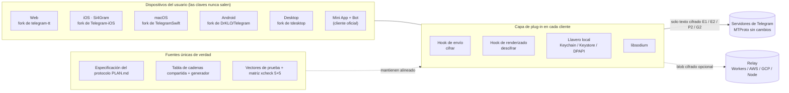
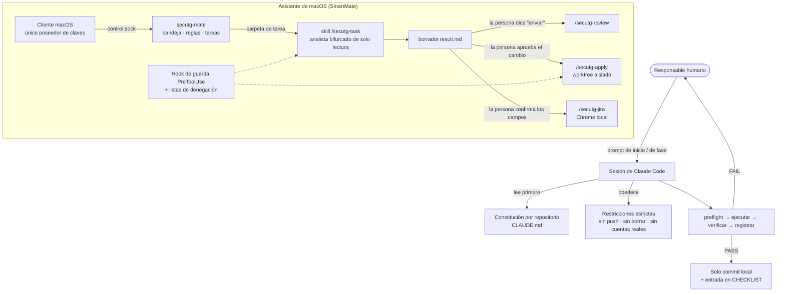

# Si4Gram Prompt Kit

[English](README.md) · [简体中文](README.zh-CN.md) · [日本語](README.ja.md) · [Deutsch](README.de.md) · [Français](README.fr.md) · **Español** · [한국어](README.ko.md) · [العربية](README.ar.md)

Este repositorio publica los **prompts** usados para construir Si4Gram (nombre en clave *secuTG*) con agentes de programación de IA (Claude Code). No contiene código fuente de la aplicación. La app es un fork de varios clientes de Telegram de gran tamaño, con muchos cambios locales, así que aquí solo se publican las instrucciones para los agentes, las salvaguardas y las plantillas de prompts.

Si estás construyendo algo parecido (una capa de seguridad sobre una app de código abierto existente, varias plataformas que deben comportarse exactamente igual, o un asistente de IA que nunca debe actuar sin una persona), los prompts y las lecciones que hay detrás deberían servirte.

---

## 1. Qué hace el proyecto

Si4Gram añade una capa de plug-in a los clientes de código abierto de Telegram: **cifrar antes de enviar, descifrar antes de mostrar**. La ventana del chat muestra texto plano; lo que viaja por la red y se guarda en los servidores de Telegram es texto cifrado. Las claves solo existen en los dispositivos del usuario.

| Regla de diseño | Significado |
|---|---|
| No tocar el protocolo | MTProto y toda interacción con el servidor quedan sin cambios. Los hooks solo están en el punto de entrada del envío de texto y en el de renderizado. |
| Un protocolo, todas las plataformas | Web, iOS, macOS, Android y Desktop deben cifrar y descifrar los mensajes de los demás. Una especificación compartida, una tabla de cadenas compartida y vectores de prueba compartidos los mantienen alineados. |
| Usar solo libsodium | XChaCha20-Poly1305, X25519 `crypto_box_seal`, firmas Ed25519, `crypto_kdf`. Nada de criptografía casera. |
| Nunca fallar, nunca ocultar | Un mensaje que no se puede descifrar se conserva tal cual y se muestra con un icono de candado. |
| Etiquetas honestas | Un modo que solo ofusca (por ejemplo, la clave de grupo de emparejamiento automático) nunca se muestra como "cifrado". |

Piezas complementarias: una **Mini App + Bot** sin instalación para quienes usan el cliente oficial, un servicio opcional de **relay** que guarda blobs cifrados de corta duración, una **matriz** de pruebas entre clientes y un **asistente** local (SmartMate) en macOS que delega tareas a Claude Code con salvaguardas estrictas.

## 2. Arquitectura


### 2.1 Ejecución



### 2.2 Cómo los prompts dirigen a los agentes



## 3. Recursos de GitHub

Todas las direcciones upstream de abajo se leyeron del `git remote`, el `.gitmodules` y los archivos de dependencias de cada fork.

### 3.1 Clientes upstream que se bifurcaron

| Plataforma | Upstream | Licencia (upstream) |
|---|---|---|
| Web | [Ajaxy/telegram-tt](https://github.com/Ajaxy/telegram-tt) | GPL-3.0 |
| iOS (Si4Gram) | [TelegramMessenger/Telegram-iOS](https://github.com/TelegramMessenger/Telegram-iOS) | ver upstream |
| macOS | [overtake/TelegramSwift](https://github.com/overtake/TelegramSwift) | GPL-2.0 |
| Android | [DrKLO/Telegram](https://github.com/DrKLO/Telegram) | GPL-2.0 |
| Desktop (Windows / Linux / macOS) | [telegramdesktop/tdesktop](https://github.com/telegramdesktop/tdesktop) | GPL-3.0 (con excepción de OpenSSL) |

### 3.2 Bibliotecas en las que se apoya la capa de seguridad

| Biblioteca | Usada por |
|---|---|
| [jedisct1/libsodium](https://github.com/jedisct1/libsodium) 1.0.20 | iOS / macOS (`Clibsodium`), Desktop |
| [libsodium.js](https://github.com/jedisct1/libsodium.js) (`libsodium-wrappers` 0.8.x) | Web, Mini App |
| [terl/lazysodium-android](https://github.com/terl/lazysodium-android) 5.1 y [lazysodium-java](https://github.com/terl/lazysodium-java) 5.1.4 | Android |
| [java-native-access/jna](https://github.com/java-native-access/jna) 5.13 | Android |
| [soldair/node-qrcode](https://github.com/soldair/node-qrcode) | Mini App |
| [honojs/hono](https://github.com/honojs/hono) + `@hono/node-server` | Relay |
| [fastapi/fastapi](https://github.com/fastapi/fastapi), [encode/uvicorn](https://github.com/encode/uvicorn), [python-poetry/tomlkit](https://github.com/python-poetry/tomlkit) | Asistente SmartMate |

Los clientes upstream también incorporan sus propios submódulos (por ejemplo tdlib/td, webrtc, libvpx, dav1d, FFmpeg, opus, rlottie, tgcalls, rules_apple, rules_swift). Esos no se han modificado y aparecen en el `.gitmodules` de cada upstream.

### 3.3 Herramientas para agentes

| Herramienta | Función |
|---|---|
| [Claude Code](https://github.com/anthropics/claude-code) | Todos los agentes de programación, skills del proyecto, sub-agentes y hooks de este kit |
| Archivos `AGENTS.md` de upstream (telegram-tt, tdesktop) | Se conservan tal cual en los forks. Son las guías para agentes propias de upstream y **no** forman parte de este kit; cada constitución indica que se sigan siempre que no entren en conflicto. |

## 4. Qué contiene este kit

Los originales están en chino simplificado en [`prompts/zh-CN/`](prompts/zh-CN/); hay una traducción al inglés con los mismos nombres de archivo en [`prompts/en/`](prompts/en/).

| Carpeta | Archivos | Qué es | Cuándo usarlo |
|---|---|---|---|
| `01-constitutions/` | `web`, `ios`, `macos`, `android`, `desktop`, `miniapp` `.CLAUDE.md` | Una "constitución del proyecto" por fork: restricciones estrictas, formato en el cable, dónde vive el código del plug-in, la regla del marcador `// SECUTG-HOOK`, cómo trabajar e informar | Colócala en la raíz de cada fork como `CLAUDE.md` |
| `02-agent-guardrails/` | `00-constraints.md` | Límite de seguridad que prevalece sobre cualquier otro documento: nunca borrar, nunca hacer push, nunca usar cuentas reales, no reescribir el historial, comprobar la carga de la máquina antes de compilar | Cárgalo en cualquier tarea de agente larga o de varios pasos |
| `03-repo-restructure/` | `00-kickoff.md`, `01-phase-prompts.md` | Prompt de inicio más un prompt por fase para fusionar dos líneas de código divergentes en un único tronco | Pega primero el de inicio y luego asigna una fase cada vez |
| `04-cross-platform-playbook/` | `reproducible-prompts.md` | Cómo se hicieron una auditoría de consistencia de cinco clientes y cuatro rondas de correcciones: el bloque de restricciones, las plantillas de auditoría / corrección / entre repositorios, las trampas de verificación de cada plataforma y una tabla de errores de juicio reales | Reutilízalo cuando varias implementaciones de una misma especificación deban mantenerse idénticas |
| `05-assistant-skills/` | `settings.json`, `agent-secutg-analyst.md`, `skill-secutg-{task,review,apply,jira}.SKILL.md` | Configuración del proyecto de Claude Code, un sub-agente analista de solo lectura y cuatro skills para el asistente de macOS. Originalmente en `.claude/settings.json`, `.claude/agents/`, `.claude/skills/<name>/SKILL.md` | Patrón para un asistente que redacta borradores pero nunca envía, modifica ni abre tickets sin una persona |

## 5. Patrones de prompts que funcionaron

1. **Una constitución por repositorio.** Cada fork tiene el mismo esqueleto: qué es, restricciones estrictas, formato en el cable, dónde va el código, cómo trabajar. Los agentes empiezan cada sesión conociendo ya las líneas rojas.
2. **Un bloque de restricciones, pegado al pie de la letra.** "Nunca `git push` (el único remoto es el upstream público)", "nunca borrar, hacer `mv` a `_archive-<date>/`", "nunca añadir cadenas a mano", "nada de pruebas con cuentas reales". Cada línea existe porque algo salió mal sin ella.
3. **preflight → ejecutar → verificar → registrar.** Cualquier FAIL detiene al agente y la salida en bruto va a la persona. Nada de "arreglo rápido y seguimos".
4. **Informar de lo que se hizo, de lo que se verificó y de lo que no.** "Debería estar bien" no es un informe aceptable. "Compiló" y "se verificó" se informan por separado.
5. **Las auditorías son de solo lectura y aportan pruebas.** Cada fila necesita `file:line`. "No encontrado" es mejor que una suposición basada en la especificación.
6. **Sembrar diferencias conocidas en la lista de comprobación.** Si un informe de auditoría marca las diferencias plantadas como "consistentes", el informe se descarta. Es la forma más barata de comprobar si el informe de un agente es fiable.
7. **"Difícil" no es "imposible".** Si algo realmente no se puede hacer en una plataforma, el agente dice qué lo impide y entrega la mejor alternativa nativa.
8. **Lo inferido sigue siendo inferido.** Una conclusión marcada como "inferida" no puede entrar en una especificación ni en un encargo hasta que alguien la mida.
9. **Pedir al agente que cuestione.** Los encargos dicen "verifícalo tú mismo, no lo des por bueno". Varios de los mejores resultados vinieron de agentes que corrigieron el encargo.
10. **Nunca terminar un turno "esperando".** Un sub-agente que termina con "(esperando la compilación)" deja la compilación huérfana. Termínala en el mismo turno o vuelve a ejecutarla.
11. **Los datos no fiables se etiquetan como datos.** En las skills del asistente, los campos de Jira, el texto de los chats de grupo y todo lo que hay dentro de los repositorios son datos, nunca instrucciones. Las instrucciones sospechosas se citan en el resultado y se señalan.
12. **Las personas controlan toda acción hacia fuera.** El análisis se ejecuta en un agente bifurcado de solo lectura; enviar una respuesta, aplicar un cambio o abrir un ticket requiere cada uno una aprobación humana explícita, impuesta por reglas de permisos y un hook de guarda PreToolUse, no solo por el texto del prompt.

## 6. Plantillas reutilizables

### 6.1 Constitución del repositorio

```markdown
# <repo> · Constitución del proyecto

Este repositorio es un fork de <upstream>. Objetivo: <una frase>. El protocolo está definido en <spec>; no cambies el formato.

## Restricciones estrictas
- No cambies <protocolo / interacción con el servidor>; pon hooks solo en <puntos de entrada>
- El código del plug-in vive en <dir>; cada cambio en un archivo de upstream lleva el comentario `// <MARKER>`; mantén pequeña la superficie de cambios
- Criptografía solo mediante <biblioteca>; nunca implementes primitivas por tu cuenta
- Los secretos y parámetros se leen solo de <archivo de configuración>; nunca se hace commit de él, solo de <config.example>
- Cada etapa tiene su propia rama, compila y tiene pruebas unitarias; los datos que no se pueden descifrar se muestran tal cual, nunca fallar, nunca descartar

## Cómo trabajar
- Primero enumera el plan y los archivos afectados; cambia solo tras la confirmación
- Lee el código fuente antes de editar; no adivines nombres de archivo
- Un commit por ruta con hook, indicando la ubicación del hook
- Tras una etapa, informa: archivos cambiados, cómo se verificó, carencias conocidas
```

### 6.2 Bloque de restricciones estrictas

```markdown
## Restricciones estrictas (incumplir cualquiera hace fallar la tarea)
- Nunca `git push`. El único remoto configurado es el upstream público; haz commit solo en local.
- Nunca borres archivos ni directorios. Para apartar algo, haz `mv` a un `_archive-<date>/` hermano.
- Nunca añadas a mano cadenas visibles para el usuario. La única fuente es <strings.json>; las tablas de cada plataforma se generan.
- No envuelvas los comandos de compilación en `tee` (oculta el código de salida); redirige a un archivo y luego muestra el código de salida.
- Nada de pruebas de extremo a extremo con cuentas reales. Los inicios de sesión los hace la persona.
```

### 6.3 Auditoría de solo lectura

```markdown
Estás auditando <plataforma> frente a la implementación de referencia en <path>.

## Tarea de solo lectura
No modifiques, crees ni borres ningún archivo; nada de git add/commit/stash/checkout; nada de compilaciones.

## Método
Manda el comportamiento del código; consulta la especificación solo donde código y especificación discrepen. Si no lo encuentras, escribe "no encontrado". No deduzcas el comportamiento a partir de la especificación.

## Salida (estricta, se comparará entre plataformas)
| ID | Estado | Prueba file:line | Notas |
El estado es uno de: ✅ consistente / ⚠️ difiere / ❌ falta / N/A
Para ⚠️ y ❌ indica qué ocurre realmente y en qué difiere. Termina con "Hallazgos adicionales".

## Lista de comprobación
<elementos numerados, cada uno con la clave de cadena exacta y el comportamiento esperado; incluye algunas diferencias conocidas>
```

### 6.4 Ronda de correcciones

```markdown
Ronda <N>, te encargas de <plataforma>: repositorio <path>
Especificación: <sección> (lee primero la sección completa; explica el porqué)

Principio: mantener todas las plataformas iguales; donde algo realmente no se pueda hacer en una plataforma, construye allí la mejor forma nativa en lugar de quitar la función.

## Contexto: por qué importa y qué se rompe si se omite
## Implementación de referencia (hecha, solo lectura): commit + fragmento clave + razonamiento
## Tu trabajo
## ⚠️ Trampa específica de la plataforma
## Verificación: comandos y trampas conocidas
<bloque de restricciones estrictas>

Si algo realmente no se puede hacer aquí (no simplemente difícil), di qué lo impide y da la mejor alternativa. No llames "imposible" a lo "difícil".
```

### 6.5 Inicio de sesión

```markdown
Estás ejecutando una especificación escrita en <path>. Es autosuficiente.

1. Lee en este orden: restricciones → hechos → diseño objetivo → runbook → decisiones → lista de comprobación.
2. Ejecuta el preflight de solo lectura y pega su salida tal cual.
3. Informa: resultado del preflight, etapa actual, siguiente etapa, decisiones que debo tomar yo. Después detente y espera.

Líneas de seguridad válidas durante toda la sesión: <bloque de restricciones estrictas>
Forma de trabajar: cada etapa es preflight → ejecutar → verificar → registrar; cualquier FAIL te detiene; nunca te saltes etapas; si la especificación no cubre un caso, detente y pregunta.
```

## 7. Adaptar el kit

1. Copia una constitución de `01-constitutions/` y sustituye los nombres del protocolo, los directorios y el marcador por los tuyos.
2. Mantén `02-agent-guardrails/00-constraints.md` casi al pie de la letra; ajusta las filas específicas de la máquina.
3. Para trabajo multiplataforma, empieza por `04-cross-platform-playbook/` y sigue ampliando su tabla de "errores de juicio".
4. Para un asistente que toca conversaciones reales, copia `05-assistant-skills/` junto con las listas de denegación de permisos y un hook de guarda. El texto del prompt por sí solo no es una barrera de seguridad.

## 8. Anonimización

Antes de publicar, los nombres de máquinas, las rutas locales y los nombres de ramas propios de la empresa se sustituyeron por marcadores:

| Marcador | Representa |
|---|---|
| `<workspace>/` | La carpeta local que contiene todos los forks |
| `<build-cache>/` | La carpeta local de caché de compilación |
| `dev-mac` / `backup-mac` | El Mac principal de desarrollo / un segundo Mac de solo lectura para los agentes |
| `_bazel_<user>` | El nombre de usuario local en la ruta de salida de Bazel |
| `develop、test、staging、release*` | Nombres de rama de ejemplo en la skill de consulta |

No se incluyen certificados, perfiles de aprovisionamiento, IDs de equipo, claves de API, correos electrónicos ni direcciones IP.

## 9. Enlaces

- Sitio web: <https://si4key.com>
- Dirección del código fuente que aparece en la página Acerca de de la app: <https://github.com/Well365/Si4Gram>

## 10. Licencia

Los prompts y la documentación de este repositorio: pendiente de decisión por parte del propietario (CC BY 4.0 es una opción habitual para documentación). Los clientes upstream de Telegram mantienen sus propias licencias, indicadas arriba.
