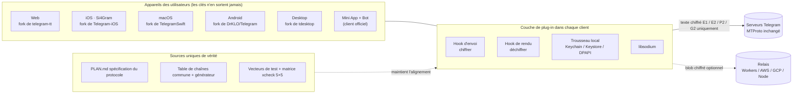
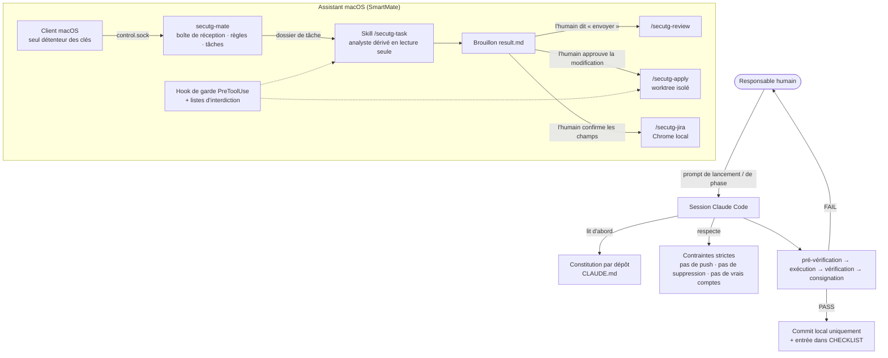

# Si4Gram Prompt Kit

[English](README.md) · [简体中文](README.zh-CN.md) · [日本語](README.ja.md) · [Deutsch](README.de.md) · **Français** · [Español](README.es.md) · [한국어](README.ko.md) · [العربية](README.ar.md)

Ce dépôt publie les **prompts** utilisés pour construire Si4Gram (nom de code *secuTG*) avec des agents de programmation IA (Claude Code). Il ne contient aucun code source de l'application. L'application est un fork de plusieurs grands clients Telegram, avec de nombreuses modifications locales ; seuls les instructions pour les agents, les garde-fous et les modèles de prompts sont donc publiés ici.

Si vous construisez quelque chose de similaire (une couche de sécurité au-dessus d'une application open source existante, plusieurs plateformes qui doivent se comporter de façon identique, ou un assistant IA qui ne doit jamais agir sans un humain), les prompts et les leçons qui les accompagnent devraient être réutilisables.

---

## 1. Ce que fait le projet

Si4Gram ajoute une couche de plug-in aux clients open source de Telegram : **chiffrer avant l'envoi, déchiffrer avant l'affichage**. La fenêtre de discussion affiche du texte en clair ; ce qui circule sur le réseau et reste sur les serveurs de Telegram est du texte chiffré. Les clés ne se trouvent que sur les appareils des utilisateurs.

| Règle de conception | Signification |
|---|---|
| Ne pas toucher au protocole | MTProto et toutes les interactions avec le serveur restent inchangés. Les hooks se placent uniquement au point d'entrée de l'envoi de texte et au point d'entrée du rendu. |
| Un protocole, toutes les plateformes | Web, iOS, macOS, Android et Desktop doivent chiffrer et déchiffrer les messages les uns des autres. Une spécification commune, une table de chaînes commune et des vecteurs de test communs les maintiennent alignés. |
| Utiliser uniquement libsodium | XChaCha20-Poly1305, X25519 `crypto_box_seal`, signatures Ed25519, `crypto_kdf`. Aucune cryptographie maison. |
| Ne jamais planter, ne jamais avaler | Un message qui ne peut pas être déchiffré est conservé tel quel et affiché avec un badge de cadenas. |
| Des libellés honnêtes | Un mode qui ne fait qu'obscurcir (par exemple la clé de groupe issue de l'appairage automatique) n'est jamais présenté comme « chiffré ». |

Éléments complémentaires : une **Mini App + Bot** sans installation pour les utilisateurs du client officiel, un service **relais** optionnel qui stocke des blobs chiffrés de courte durée, une **matrice** de tests entre clients, et un **assistant** local (SmartMate) sous macOS qui confie des tâches à Claude Code sous des garde-fous stricts.

## 2. Architecture


### 2.1 Exécution



### 2.2 Comment les prompts pilotent les agents



## 3. Ressources GitHub

Toutes les adresses upstream ci-dessous ont été lues dans le `git remote`, le `.gitmodules` et les fichiers de dépendances de chaque fork.

### 3.1 Clients upstream qui ont été forkés

| Plateforme | Upstream | Licence (upstream) |
|---|---|---|
| Web | [Ajaxy/telegram-tt](https://github.com/Ajaxy/telegram-tt) | GPL-3.0 |
| iOS (Si4Gram) | [TelegramMessenger/Telegram-iOS](https://github.com/TelegramMessenger/Telegram-iOS) | voir l'upstream |
| macOS | [overtake/TelegramSwift](https://github.com/overtake/TelegramSwift) | GPL-2.0 |
| Android | [DrKLO/Telegram](https://github.com/DrKLO/Telegram) | GPL-2.0 |
| Desktop (Windows / Linux / macOS) | [telegramdesktop/tdesktop](https://github.com/telegramdesktop/tdesktop) | GPL-3.0 (avec exception OpenSSL) |

### 3.2 Bibliothèques sur lesquelles repose la couche de sécurité

| Bibliothèque | Utilisée par |
|---|---|
| [jedisct1/libsodium](https://github.com/jedisct1/libsodium) 1.0.20 | iOS / macOS (`Clibsodium`), Desktop |
| [libsodium.js](https://github.com/jedisct1/libsodium.js) (`libsodium-wrappers` 0.8.x) | Web, Mini App |
| [terl/lazysodium-android](https://github.com/terl/lazysodium-android) 5.1 et [lazysodium-java](https://github.com/terl/lazysodium-java) 5.1.4 | Android |
| [java-native-access/jna](https://github.com/java-native-access/jna) 5.13 | Android |
| [soldair/node-qrcode](https://github.com/soldair/node-qrcode) | Mini App |
| [honojs/hono](https://github.com/honojs/hono) + `@hono/node-server` | Relais |
| [fastapi/fastapi](https://github.com/fastapi/fastapi), [encode/uvicorn](https://github.com/encode/uvicorn), [python-poetry/tomlkit](https://github.com/python-poetry/tomlkit) | Assistant SmartMate |

Les clients upstream intègrent aussi leurs propres sous-modules (par exemple tdlib/td, webrtc, libvpx, dav1d, FFmpeg, opus, rlottie, tgcalls, rules_apple, rules_swift). Ceux-ci sont inchangés et listés dans le `.gitmodules` de chaque upstream.

### 3.3 Outils pour les agents

| Outil | Rôle |
|---|---|
| [Claude Code](https://github.com/anthropics/claude-code) | Tous les agents de programmation, skills de projet, sous-agents et hooks de ce kit |
| Fichiers `AGENTS.md` upstream (telegram-tt, tdesktop) | Conservés tels quels dans les forks. Ce sont les propres guides pour agents de l'upstream ; ils ne font **pas** partie de ce kit. Chaque constitution demande de les suivre lorsqu'ils n'entrent pas en conflit. |

## 4. Contenu du kit

Les originaux sont en chinois simplifié dans [`prompts/zh-CN/`](prompts/zh-CN/) ; une traduction anglaise avec les mêmes noms de fichiers se trouve dans [`prompts/en/`](prompts/en/).

| Dossier | Fichiers | De quoi il s'agit | Quand l'utiliser |
|---|---|---|---|
| `01-constitutions/` | `web`, `ios`, `macos`, `android`, `desktop`, `miniapp` `.CLAUDE.md` | Une « constitution de projet » par fork : contraintes strictes, format sur le réseau, emplacement du code de plug-in, règle du marqueur `// SECUTG-HOOK`, façon de travailler et de rendre compte | À placer à la racine de chaque fork sous le nom `CLAUDE.md` |
| `02-agent-guardrails/` | `00-constraints.md` | Limite de sécurité qui prime sur tout autre document : ne jamais supprimer, ne jamais pousser, ne jamais utiliser de vrais comptes, pas de réécriture de l'historique, vérifier la charge de la machine avant de compiler | À charger dans toute tâche d'agent longue ou en plusieurs étapes |
| `03-repo-restructure/` | `00-kickoff.md`, `01-phase-prompts.md` | Prompt de lancement plus un prompt par phase pour fusionner deux lignes de code divergentes en un seul tronc | Coller d'abord le lancement, puis confier une phase à la fois |
| `04-cross-platform-playbook/` | `reproducible-prompts.md` | Comment se sont déroulés un audit de cohérence sur cinq clients et quatre séries de corrections : le bloc de contraintes, les modèles d'audit / de correction / de travail entre dépôts, les pièges de vérification propres à chaque plateforme et un tableau d'erreurs d'appréciation réelles | À réutiliser lorsque plusieurs implémentations d'une même spécification doivent rester identiques |
| `05-assistant-skills/` | `settings.json`, `agent-secutg-analyst.md`, `skill-secutg-{task,review,apply,jira}.SKILL.md` | Paramètres de projet Claude Code, un sous-agent analyste en lecture seule et quatre skills pour l'assistant macOS. À l'origine dans `.claude/settings.json`, `.claude/agents/`, `.claude/skills/<name>/SKILL.md` | Modèle pour un assistant qui rédige des brouillons mais n'envoie jamais rien, ne modifie rien et ne crée aucun ticket sans un humain |

## 5. Les modèles de prompts qui ont fonctionné

1. **Une constitution par dépôt.** Chaque fork suit le même squelette : ce que c'est, contraintes strictes, format sur le réseau, où va le code, comment travailler. Les agents commencent chaque session en connaissant déjà les lignes rouges.
2. **Un seul bloc de contraintes, collé mot pour mot.** « Ne jamais faire `git push` (le seul remote est l'upstream public) », « ne jamais supprimer, déplacer avec `mv` vers `_archive-<date>/` », « ne jamais ajouter de chaînes à la main », « pas de tests sur de vrais comptes ». Chaque ligne existe parce que quelque chose a mal tourné sans elle.
3. **pré-vérification → exécution → vérification → consignation.** Tout FAIL arrête l'agent et la sortie brute est transmise à l'humain. Pas de « petite correction et on continue ».
4. **Rendre compte de ce qui a été fait, de ce qui a été vérifié et de ce qui ne l'a pas été.** « Ça devrait aller » n'est pas un compte rendu acceptable. « Ça compile » et « c'est vérifié » sont signalés séparément.
5. **Les audits sont en lecture seule et apportent des preuves.** Chaque ligne exige un `file:line`. « Introuvable » vaut mieux qu'une supposition fondée sur la spécification.
6. **Glisser des écarts connus dans la checklist.** Si un rapport d'audit marque les différences volontairement introduites comme « cohérentes », le rapport est rejeté. C'est le moyen le moins coûteux de tester si l'on peut se fier au rapport d'un agent.
7. **« Difficile » ne veut pas dire « impossible ».** Si quelque chose est réellement irréalisable sur une plateforme, l'agent explique ce qui bloque et livre la meilleure alternative native.
8. **Ce qui est déduit reste déduit.** Une conclusion marquée « déduite » ne peut entrer dans une spécification ou un brief de tâche qu'une fois mesurée par quelqu'un.
9. **Demander à l'agent de contester.** Les briefs disent « vérifie-le toi-même, ne le prends pas pour acquis ». Plusieurs des meilleurs résultats sont venus d'agents qui ont corrigé le brief.
10. **Ne jamais terminer un tour sur « en attente ».** Un sous-agent qui se termine par « (en attente de la compilation) » laisse une compilation orpheline. La terminer dans le même tour ou la relancer.
11. **Les données non fiables sont étiquetées comme des données.** Dans les skills de l'assistant, les champs Jira, le texte des discussions de groupe et tout ce qui se trouve dans les dépôts sont des données, jamais des instructions. Les instructions suspectes sont citées dans le résultat et signalées.
12. **Les humains gardent la main sur toute action vers l'extérieur.** L'analyse s'exécute dans un agent dérivé en lecture seule ; envoyer une réponse, appliquer une modification ou créer un ticket exige chaque fois une approbation humaine explicite, imposée par des règles de permission et un hook de garde PreToolUse, et pas seulement par le texte du prompt.

## 6. Modèles réutilisables

### 6.1 Constitution de dépôt

```markdown
# <repo> · Constitution du projet

Ce dépôt est un fork de <upstream>. Objectif : <une phrase>. Le protocole est défini dans <spec> ; ne pas modifier le format.

## Contraintes strictes
- Ne pas modifier <protocole / interaction avec le serveur> ; se brancher uniquement sur <points d'entrée>
- Le code de plug-in se trouve dans <dir> ; toute modification d'un fichier upstream porte le commentaire `// <MARKER>` ; garder la surface de modification réduite
- Cryptographie uniquement via <library> ; ne jamais implémenter soi-même les primitives
- Les secrets et paramètres sont lus uniquement depuis <config file> ; il n'est jamais commité, seul <config.example> l'est
- Chaque étape a sa propre branche, compile et a des tests unitaires ; les données indéchiffrables sont affichées telles quelles, ne jamais planter, ne jamais les perdre

## Façon de travailler
- Lister d'abord le plan et les fichiers concernés ; ne modifier qu'après confirmation
- Lire le code source avant de le modifier ; ne pas deviner les noms de fichiers
- Un commit par chemin intercepté, en indiquant l'emplacement du hook
- Après une étape, rendre compte : fichiers modifiés, méthode de vérification, lacunes connues
```

### 6.2 Bloc de contraintes strictes

```markdown
## Contraintes strictes (en enfreindre une seule fait échouer la tâche)
- Ne jamais faire `git push`. Le seul remote configuré est l'upstream public ; commiter uniquement en local.
- Ne jamais supprimer de fichiers ou de répertoires. Pour écarter quelque chose, le déplacer avec `mv` dans un `_archive-<date>/` voisin.
- Ne jamais ajouter à la main de chaînes visibles par l'utilisateur. La source unique est <strings.json> ; les tables par plateforme sont générées.
- Ne pas envelopper les commandes de compilation dans `tee` (cela masque le code de sortie) ; rediriger vers un fichier, puis afficher le code de sortie.
- Pas de tests de bout en bout sur de vrais comptes. Les connexions sont faites par l'humain.
```

### 6.3 Audit en lecture seule

```markdown
Tu audites <platform> par rapport à l'implémentation de référence dans <path>.

## Tâche en lecture seule
Ne modifier, créer ni supprimer aucun fichier ; pas de git add/commit/stash/checkout ; pas de compilation.

## Méthode
Le comportement du code prime ; ne consulter la spécification que là où code et spécification divergent. Si tu ne trouves pas, écris « introuvable ». Ne pas déduire le comportement de la spécification.

## Sortie (stricte, elle sera comparée entre plateformes)
| ID | Statut | Preuve file:line | Remarques |
Le statut est l'un de : ✅ cohérent / ⚠️ différent / ❌ manquant / N/A
Pour ⚠️ et ❌, indiquer ce qui se passe réellement et en quoi cela diffère. Terminer par « Constats supplémentaires ».

## Checklist
<éléments numérotés, chacun indiquant la clé de chaîne exacte et le comportement attendu ; y inclure quelques écarts connus>
```

### 6.4 Série de corrections

```markdown
Série <N>, tu es responsable de <platform> : dépôt <path>
Spécification : <section> (lire d'abord toute la section ; elle explique le pourquoi)

Principe : garder toutes les plateformes identiques ; là où quelque chose est réellement irréalisable sur une plateforme, y construire la meilleure forme native au lieu d'abandonner la fonctionnalité.

## Contexte — pourquoi c'est important, et ce qui casse si on l'omet
## Implémentation de référence (terminée, lecture seule) — commit + extrait clé + raisonnement
## Ton travail
## ⚠️ Piège propre à la plateforme
## Vérification — commandes et pièges connus
<bloc de contraintes strictes>

Si quelque chose est réellement irréalisable ici (pas seulement difficile), dis ce qui bloque et propose la meilleure alternative. Ne qualifie pas de « impossible » ce qui est « difficile ».
```

### 6.5 Lancement de session

```markdown
Tu exécutes une spécification écrite qui se trouve dans <path>. Elle est autonome.

1. Lire dans l'ordre : contraintes → faits → conception cible → runbook → décisions → checklist.
2. Lancer la pré-vérification en lecture seule et coller sa sortie mot pour mot.
3. Rendre compte : résultat de la pré-vérification, étape actuelle, étape suivante, décisions que je dois prendre. Puis s'arrêter et attendre.

Règles de sécurité valables pour toute la session : <bloc de contraintes strictes>
Façon de travailler : chaque étape suit pré-vérification → exécution → vérification → consignation ; tout FAIL t'arrête ; ne jamais sauter d'étape ; si la spécification ne couvre pas un cas, s'arrêter et demander.
```

## 7. Adapter le kit

1. Copier une constitution depuis `01-constitutions/` et remplacer les noms de protocole, de répertoire et de marqueur par les vôtres.
2. Garder `02-agent-guardrails/00-constraints.md` presque mot pour mot ; ajuster les lignes propres à la machine.
3. Pour un travail multiplateforme, partir de `04-cross-platform-playbook/` et continuer d'enrichir son tableau des « erreurs d'appréciation ».
4. Pour un assistant qui touche à de vraies conversations, copier `05-assistant-skills/` avec les listes d'interdiction des permissions et un hook de garde. Le texte du prompt seul ne constitue pas une limite de sécurité.

## 8. Anonymisation

Avant la publication, les noms de machines, les chemins locaux et les noms de branches propres à l'entreprise ont été remplacés par des espaces réservés :

| Espace réservé | Signification |
|---|---|
| `<workspace>/` | Le dossier local qui contient tous les forks |
| `<build-cache>/` | Le dossier local du cache de compilation |
| `dev-mac` / `backup-mac` | Le Mac de développement principal / un second Mac en lecture seule pour les agents |
| `_bazel_<user>` | Le nom d'utilisateur local dans le chemin de sortie de Bazel |
| `develop、test、staging、release*` | Exemples de noms de branches dans le skill de requête |

Aucun certificat, profil de provisionnement, identifiant d'équipe, clé d'API, adresse e-mail ou adresse IP n'est inclus.

## 9. Liens

- Site web : <https://si4key.com>
- Adresse du code source affichée dans la page À propos de l'application : <https://github.com/Well365/Si4Gram>

## 10. Licence

Les prompts et la documentation de ce dépôt : à décider par le propriétaire (CC BY 4.0 est un choix courant pour la documentation). Les clients Telegram upstream conservent leurs propres licences, indiquées ci-dessus.
